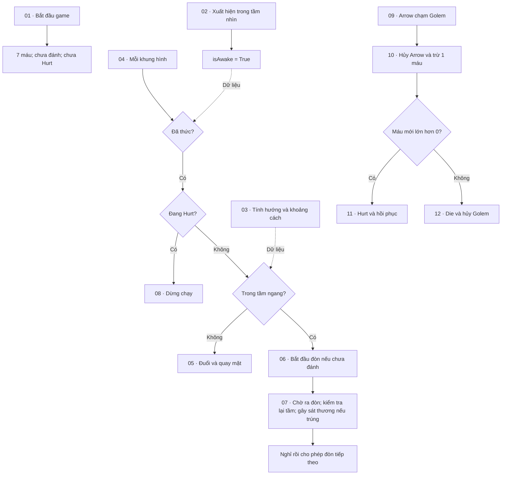

# Luồng hoạt động Golem Blue

Mở **Enemy → Golem_blue → Script Machine → Edit Graph** để xem `GolemBlueCombat`.
Graph được chia thành 12 khung màu có đánh số. Phóng to khung cần giải thích để đọc các node.
Chọn một khung để đọc phần **Comment** trong Graph Inspector.

| Khung | Chức năng | Nội dung cần trình bày |
|---|---|---|
| 01 | Khởi tạo | On Start đặt 7 máu và đặt isAttacking, isHurt bằng False. |
| 02 | Phát hiện Player | On Became Visible đặt isAwake bằng True. Camera Scene view cũng có thể kích hoạt sự kiện này trong Editor. |
| 03 | Hướng và khoảng cách | Tính Player X − Golem X; so sánh dấu để chọn hướng; dùng Abs và attackRange để kiểm tra tầm ngang. Đây là dữ liệu dùng chung. |
| 04 | Chọn hành vi | On Update kiểm tra isAwake, isHurt và tầm đánh để chọn nhánh. |
| 05 | Đuổi và quay mặt | Vận tốc X dương/âm, Flip X và Animator isWalk theo hướng Player. |
| 06 | Bắt đầu đòn đánh | Dừng chạy, kiểm tra isAttacking, khóa đòn mới, phát doAttack rồi bắt đầu Timer attackDelay. |
| 07 | Gây sát thương và nghỉ | Kiểm tra lại tầm; trúng thì gửi PlayerTakeDamage. Trúng hoặc hụt đều chờ attackRecovery rồi trả isAttacking về False. |
| 08 | Dừng trong lúc Hurt | isHurt đang True thì dừng vận tốc X và tắt isWalk. |
| 09 | Nhận Arrow và lọc tag | On Trigger Enter 2D lấy đối tượng vừa chạm, kiểm tra tag PlayerArrow và health > 0. |
| 10 | Trừ máu và rẽ nhánh | Hủy Arrow; trừ 1 máu; dùng giá trị vừa lưu để chọn Hurt hoặc Die. |
| 11 | Hurt và hồi phục | Đặt isHurt=True, phát gotHit, chờ 0.36 giây, đặt isHurt=False. |
| 12 | Chết và hủy Golem | Phát doDie, dừng vật lý, tắt collider, lên lịch hủy sau 0.85 giây, tắt Script Machine. |

## Ba luồng nên trình bày

**Flow trắng** cho biết thứ tự thực hiện. **Dây Data** truyền giá trị để các node tính toán và kiểm tra điều kiện.
Các biến health, Player, moveSpeed, attackRange, isAwake, isAttacking, isHurt thuộc **Object**.
isWalk, doAttack, gotHit, doDie thuộc **Animator Parameters**.

Những phần đã học thêm khi làm: Mathf Abs, đọc Transform.position và Vector3.x,
Set Linear Velocity X, Custom Event/Trigger Custom Event, và This.

Lần sắp xếp này chỉ thay đổi vị trí node, thêm khung và mô tả.
Mọi node hành vi, giá trị, dây Flow/Data, GUID và thứ tự tham chiếu được đối chiếu với bản sao trước khi sửa.
Các khung không tạo thêm hành vi; không cần chạy lại toàn bộ kiểm thử chiến đấu chỉ vì việc chia khung.