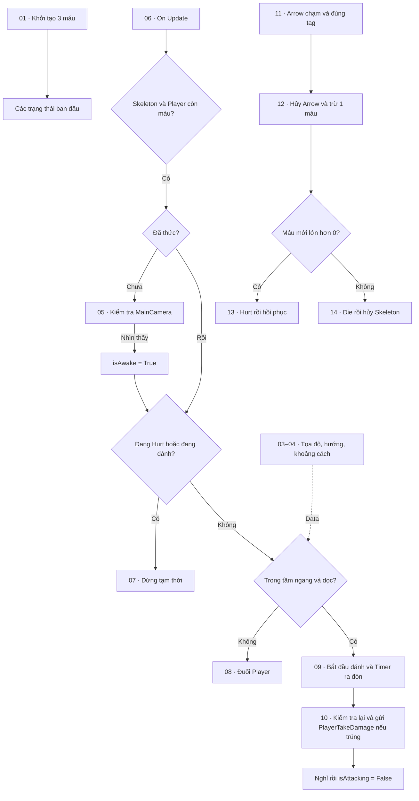

# Luồng hoạt động Skeleton

Mở **Enemy → Skeleton → Script Machine → Edit Graph** để xem `SkeletonCombat`.
Graph được sắp thành **14 khung màu có đánh số**, cùng cách trình bày với Golem Blue.
Phóng to từng khung để đọc node. Chọn khung và đọc **Comment** trong Graph Inspector để xem giải thích.

| Khung | Chức năng | Giải thích khi trình bày |
|---|---|---|
| 01 | Khởi tạo | On Start đặt health = 3, isAwake/isHurt/isAttacking = False. |
| 02 | Tham chiếu | This là Skeleton; Player và MainCamera lấy từ Object Variables. Các node khác dùng chúng làm Target. |
| 03 | Tọa độ nhân vật | Lấy tâm collider của Player và Skeleton, đọc tọa độ X/Y. |
| 04 | Hướng và tầm đánh | Tính khoảng cách ngang/dọc, xác định hướng quay mặt và vận tốc đuổi. Tầm đánh yêu cầu cả hai khoảng cách đều phù hợp. |
| 05 | Camera phát hiện | Kiểm tra vị trí Skeleton trong viewport của MainCamera. Nhìn thấy thì đặt isAwake = True. |
| 06 | Chọn hành vi | On Update kiểm tra máu Skeleton, máu Player, đã thức hay chưa, có đang Hurt/đang đánh không và Player có trong tầm không. |
| 07 | Dừng tạm thời | Dừng vận tốc X và đặt Animator isWalk = False khi cần chờ. |
| 08 | Đuổi Player | Quay mặt theo Player, đặt vận tốc X, phát Walking. |
| 09 | Bắt đầu đòn đánh | Đến gần thì dừng, đặt isAttacking = True, phát doAttack, bắt đầu Timer attackDelay. |
| 10 | Đòn trúng và nghỉ | Tại thời điểm ra đòn, kiểm tra lại máu hai bên, tầm đánh và trạng thái Hurt. Nếu hợp lệ, gửi PlayerTakeDamage. Trúng/hụt đều nghỉ trước đòn tiếp theo. |
| 11 | Nhận Arrow | Bắt On Trigger Enter 2D, lấy GameObject vừa chạm, kiểm tra tag PlayerArrow và Skeleton còn máu. |
| 12 | Trừ máu | Hủy Arrow, trừ đúng 1 máu rồi chọn nhánh Hurt hoặc chết. |
| 13 | Hurt và hồi phục | isHurt = True, dừng chạy, phát gotHit; sau 0.36 giây đặt lại isHurt = False. |
| 14 | Chết và hủy Skeleton | Phát doDie, dừng vận tốc, tắt trọng lực/collider và hủy GameObject sau 0.95 giây. |

## Ba luồng cần hiểu

**Bắt đầu:** khung 01 đặt lại máu và trạng thái. Khung 02 cung cấp tham chiếu dùng chung; đây là Data, không phải hành vi chạy tuần tự sau khung 01.

**Đuổi và đánh:** khung 06 chạy mỗi frame. Khi chưa thức, nó kiểm tra camera ở khung 05. Khi đã thức và hai bên còn sống, nó chọn dừng (07), đuổi (08), hoặc bắt đầu đánh (09). Timer ở khung 09 hoàn tất mới gọi khung 10. Các điều kiện hướng và khoảng cách lấy từ khung 03–04.

**Nhận sát thương:** Arrow chạm khung 11 → khung 12 hủy Arrow và trừ máu → còn máu đi đến khung 13, hết máu đi đến khung 14.

## Biến và dây nối

- **Object Variables:** health, moveSpeed, Player, MainCamera, attackRange, attackVerticalRange, attackDelay, attackRecovery, isAwake, isHurt, isAttacking. PlayerHealth được đọc trên Object Player.
- **Animator Parameters:** isWalk là Boolean; doAttack, gotHit, doDie là Trigger.
- **Flow trắng:** thứ tự thực hiện hành vi. **Data:** truyền giá trị, tham chiếu và điều kiện.
- **Timer ra đòn:** chờ đến lúc gây sát thương. **Timer nghỉ:** chờ cho phép đánh tiếp. **Timer Hurt:** chờ hồi phục sau khi bị tên trúng.

Các phần kiến thức bổ sung đã dùng: Custom Event/Trigger Custom Event, Camera.WorldToViewportPoint, Bounds.center, đọc X/Y, Mathf Abs/Sign, And/Negate và This.

Lần sắp xếp này thay vị trí node, khung nhóm, mô tả và góc nhìn graph. Toàn bộ **141 node, 181 dây nối**, giá trị và thứ tự tham chiếu được giữ nguyên và đối chiếu với bản sao lưu trong `Backups/SkeletonGraphLayout`.
