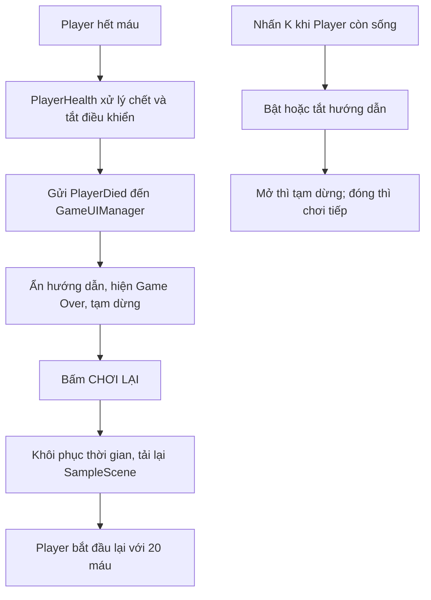

# Game Over, Chơi lại và Hướng dẫn phím K

Tài liệu mô tả cách đã thiết lập hai Canvas và các luồng Visual Scripting trong Archer Survival, Unity **6000.3.22f1**. Không sử dụng script C#.

## 1. Các phần đã tạo

| Thành phần | Vị trí | Công dụng |
|---|---|---|
| `GameOverCanvas` | GameObject gốc trong Hierarchy | Hiện Game Over và nút Chơi lại |
| `InstructionsCanvas` | GameObject gốc trong Hierarchy | Hiện hướng dẫn khi nhấn K |
| `GameUIManager` | GameObject gốc, luôn bật | Nhận sự kiện chết, phím K và các nút |
| Graph giao diện | `Assets/Script/GameUIManager.asset` | Chạy trên Script Machine của GameUIManager |
| Graph máu | `Assets/Script/PlayerHealth.asset` | Khi Player chết, gửi sự kiện đến GameUIManager |

Luồng tổng quát:



## 2. Bước 1 — Chuẩn bị hai Canvas

### Canvas hướng dẫn

Chọn **InstructionsCanvas** trong Hierarchy. GameObject này có:

- **Rect Transform**.
- **Canvas**: Render Mode = **Screen Space - Overlay**, Sort Order = **20**.
- **Canvas Scaler**: UI Scale Mode = **Scale With Screen Size**, Reference Resolution = **1920 × 1080**, Match = **0.5**.
- **Graphic Raycaster**: nhận thao tác chuột trên nút UI.

Mình chuyển phần **Introduce** bạn đã dựng sang làm con của InstructionsCanvas và dùng lại sprite nền bảng của bạn. Bên trong có tiêu đề, giới thiệu, các phím điều khiển và nút đóng.

```text
InstructionsCanvas
└── Introduce
    └── Background
        ├── Image                 ← nền bảng có sẵn
        ├── Text (TMP)            ← tiêu đề hướng dẫn
        ├── Introduction
        ├── Các dòng phím và hành động
        ├── HelpTip
        └── CloseHelpButton
            └── CloseHelpButton_Label
```

Nội dung hướng dẫn:

| Phím | Hành động |
|---|---|
| **A / D** | Di chuyển sang trái / phải |
| **Space** | Nhảy |
| **J** | Kéo cung và bắn mũi tên |
| **K** | Mở hoặc đóng hướng dẫn |

Canvas HUD đang có cũng được thêm chữ nhắc **[ K ] Hướng dẫn** ở góc trên bên phải, GameObject tên `HelpHint_K`.

### Canvas Game Over

Chọn **GameOverCanvas** trong Hierarchy. Các component giống InstructionsCanvas, nhưng **Sort Order = 30** để màn hình Game Over nằm trên các UI còn lại.

```text
GameOverCanvas
└── DimBackground
    └── GameOverPanel
        ├── TopAccent
        ├── GameName
        ├── GameOverTitle
        ├── GameOverMessage
        ├── PlayAgainButton
        │   └── PlayAgainButton_Label
        └── RestartNote
```

Các chữ dùng **TextMeshPro**. Mình bổ sung TMP Essential Resources từ gói TextMeshPro có sẵn trong Unity để các chữ có font và material cần thiết.

Hai GameObject Canvas được lưu ở trạng thái **tắt**. Chúng được bật khi có sự kiện tương ứng. **GameUIManager phải luôn bật** để tiếp tục nhận phím và nút khi hai Canvas đang ẩn.

## 3. Bước 2 — Gán biến cho GameUIManager và Player

Chọn **GameUIManager**. GameObject này có **Variables** và **Script Machine**; Script Machine dùng graph **GameUIManager**.

Trong Variables của GameUIManager, các biến đều là **Object Variables**, kiểu **GameObject**:

| Tên biến chính xác | Value cần gán |
|---|---|
| `Player` | GameObject Player |
| `HelpCanvas` | GameObject InstructionsCanvas |
| `GameOverCanvas` | GameObject GameOverCanvas |
| `RestartButton` | GameObject PlayAgainButton, có component Button |
| `CloseHelpButton` | GameObject CloseHelpButton, có component Button |

**Lưu ý tên:** biến `HelpCanvas` tham chiếu GameObject **InstructionsCanvas**; biến `RestartButton` tham chiếu GameObject **PlayAgainButton**. Tên biến và tên GameObject không bắt buộc giống nhau.

Sau đó chọn **Player > Variables**. Mình thêm:

| Tên biến | Phạm vi | Kiểu | Value |
|---|---|---|---|
| `GameUIManager` | Object trên Player | GameObject | GameObject GameUIManager |

Player tiếp tục dùng các Object Variables có sẵn: `PlayerHealth = 20`, `maxHealth = 20`, `isDead = False` và `PlayerControls` tham chiếu Script Machine điều khiển nhân vật.

## 4. Bước 3 — Khởi tạo giao diện khi vào scene

Chọn **GameUIManager > Script Machine > Edit Graph**. Tìm khung:

**`01 | BAT DAU - AN HAI CANVAS`**

### Node và giá trị

| Node | Thiết lập |
|---|---|
| **On Start** | Sự kiện bắt đầu |
| **Time Set Time Scale** | Giá trị `1` |
| **Get Variable** | Object, `HelpCanvas`, Object = This |
| **Game Object Set Active** | Value = `False`, Target lấy từ HelpCanvas |
| **Get Variable** | Object, `GameOverCanvas`, Object = This |
| **Game Object Set Active** | Value = `False`, Target lấy từ GameOverCanvas |

`This` ở khung này là GameUIManager đang chạy graph. Các Get Variable đang dùng đối tượng mặc định This; không phải lấy biến từ Player.

### Nối Flow — mũi tên trắng

```text
On Start
    → Time Set Time Scale = 1
    → Game Object Set Active: HelpCanvas = False
    → Game Object Set Active: GameOverCanvas = False
```

### Nối Data

- Get Variable `HelpCanvas` → **Value** nối vào **Target** của Set Active thứ nhất.
- Get Variable `GameOverCanvas` → **Value** nối vào **Target** của Set Active thứ hai.

**Kết quả cần kiểm tra:** bắt đầu game thì chơi bình thường, hai bảng đều ẩn. Đặt Time Scale về `1` giúp scene bắt đầu với tốc độ bình thường.

## 5. Bước 4 — PlayerHealth báo cho giao diện khi Player chết

Chọn **Player > Script Machine dùng graph PlayerHealth > Edit Graph**. Tìm khung:

**`05 | BAO UI HIEN GAME OVER`**

Phần xử lý chết có sẵn thực hiện:

```text
Máu sau khi trừ không còn lớn hơn 0
    → Set Object isDead = True
    → Animator Play: Death
    → Rigidbody2D Set Linear Velocity = (0, 0)
    → Rigidbody2D Set Gravity Scale = 0
    → Box Collider 2D Set Enabled = False
    → Script Machine PlayerControls Set Enabled = False
```

Mình nối thêm sự kiện vào cuối chuỗi trên:

### Node cần dùng

- **This**: Player đang chạy PlayerHealth; khung này dùng một This riêng.
- **Get Variable**: phạm vi **Object**, tên **`GameUIManager`**.
- **Trigger Custom Event**: tên **`PlayerDied`**, số đối số **0**.

### Nối Data

| Từ node/cổng | Đến node/cổng |
|---|---|
| This → Self | Get Variable `GameUIManager` → Object |
| Get Variable `GameUIManager` → Value | Trigger Custom Event → Target |

### Nối Flow

```text
Script Machine Set Enabled = False của PlayerControls
    → Trigger Custom Event: PlayerDied
```

Sự kiện được gửi đến **GameUIManager**, không gửi ngược vào Player. Component bị tắt là **PlayerControls**, còn graph PlayerHealth vẫn chạy và gửi được sự kiện.

**Phân biệt hai tên sự kiện:** `PlayerTakeDamage` dùng để Player nhận sát thương; `PlayerDied` dùng để Player báo đã chết cho UI. Cần nhập đúng tên và chữ hoa/chữ thường.

## 6. Bước 5 — Nhận PlayerDied và hiện Game Over

Chọn **GameUIManager > Edit Graph**. Tìm khung:

**`04 | PLAYER CHET - HIEN GAME OVER`**

### Node và giá trị

| Node | Thiết lập |
|---|---|
| **Custom Event** | Name = `PlayerDied`, Arguments = `0`, Target = This |
| **Get Variable** | Object, `HelpCanvas`, Object = This |
| **Game Object Set Active** | Target = HelpCanvas, Value = `False` |
| **Get Variable** | Object, `GameOverCanvas`, Object = This |
| **Game Object Set Active** | Target = GameOverCanvas, Value = `True` |
| **Time Set Time Scale** | Giá trị `0` |

### Nối Flow

```text
Custom Event: PlayerDied
    → HelpCanvas Set Active = False
    → GameOverCanvas Set Active = True
    → Time Set Time Scale = 0
```

### Nối Data

- Get Variable `HelpCanvas` → Value nối vào Target của node tắt hướng dẫn.
- Get Variable `GameOverCanvas` → Value nối vào Target của node hiện Game Over.

**Kết quả cần kiểm tra:** Player hết máu thì bảng hướng dẫn được đóng, Game Over hiện ra và game tạm dừng.

Trong bản hiện tại, UI được gọi ngay sau chuỗi xử lý chết và Time Scale được đặt về `0` ngay. Không có Timer chờ chạy hết animation Death trước khi hiện bảng; animation dùng thời gian thông thường cũng dừng theo game.

## 7. Bước 6 — Nút Chơi lại tải lại SampleScene

Trong graph **GameUIManager**, tìm khung:

**`05 | BUTTON CHOI LAI - LOAD SAMPLESCENE`**

### Node và giá trị

| Node | Thiết lập |
|---|---|
| **Get Variable** | Object, `RestartButton`, Object = This |
| **On Button Click** | Target lấy từ RestartButton |
| **Time Set Time Scale** | Giá trị `1` |
| **Scene Manager Load Scene** | Chọn overload nhận **String sceneName**, nhập `SampleScene` |

### Nối Data

Get Variable `RestartButton` → Value nối vào **Target** của **On Button Click**.

### Nối Flow

```text
On Button Click: PlayAgainButton
    → Time Set Time Scale = 1
    → Scene Manager Load Scene: SampleScene
```

Phải đặt Time Scale về `1` **trước khi** tải scene để lần chơi mới không tiếp tục ở trạng thái tạm dừng.

Khi scene tải lại:

1. PlayerHealth chạy On Start, đặt `PlayerHealth = maxHealth`, hiện là **20**, và `isDead = False`.
2. Các component điều khiển/collider được tạo lại theo trạng thái đã lưu trong scene.
3. GameUIManager chạy On Start, ẩn hai bảng và đặt Time Scale về `1`.

Trong **File > Build Profiles > Scene List**, scene `Assets/Scenes/SampleScene.unity` đã có trong danh sách và được bật. Nếu sau này đổi tên scene, phải sửa chuỗi `SampleScene` trong node Load Scene và kiểm tra lại Scene List.

**Về Inspector Button On Click():** phần Persistent Calls đang để trống vì graph nhận click bằng node **On Button Click**, có Target là GameObject nút. Vì vậy không cần gán thêm một hàm trong danh sách On Click() của Button cho cùng thao tác.

## 8. Bước 7 — Nhấn K để mở hoặc đóng hướng dẫn

Trong graph **GameUIManager**, tìm khung:

**`02 | PHIM K - BAT / TAT HUONG DAN`**

### Phần A — Phát hiện phím và kiểm tra Player còn sống

Các node:

- **On Update**.
- **Input Get Key Down**, chọn overload nhận **KeyCode**, Key = **K**.
- **If thứ nhất**: kiểm tra vừa nhấn K hay chưa.
- **Get Variable — Object — `Player`**, Object = This, lấy GameObject Player.
- **Get Variable — Object — `isDead`**, Object lấy từ biến Player ở trên.
- **If thứ hai**: kiểm tra Player đã chết hay chưa.

Nối Data:

| Từ node/cổng | Đến node/cổng |
|---|---|
| Input Get Key Down (K) → Result | If thứ nhất → Condition |
| Get Variable `Player` → Value | Get Variable `isDead` → Object |
| Get Variable `isDead` → Value | If thứ hai → Condition |

Nối Flow:

```text
On Update → If vừa nhấn K?
    True → If Player.isDead?
        False → Thực hiện bật/tắt bảng hướng dẫn
```

Nhánh True của If isDead không nối tiếp: khi đã chết thì K không mở bảng hướng dẫn đè lên Game Over.

### Phần B — Đảo trạng thái hiển thị

Các node:

- **Get Variable — Object — `HelpCanvas`**, Object = This.
- **Game Object Get Active Self**: đọc thuộc tính `activeSelf`.
- **Negate**, trong nhóm **Logic**: đảo Boolean.
- **Game Object Set Active**: Target là HelpCanvas.

Nối Data:

| Từ node/cổng | Đến node/cổng |
|---|---|
| Get Variable `HelpCanvas` → Value | Game Object Get Active Self → Target |
| Game Object Get Active Self → Value | Negate → X |
| Negate → ~X | Game Object Set Active → Value |
| Get Variable `HelpCanvas` → Value | Game Object Set Active → Target |

Nối Flow: **False của If isDead** → đầu vào Flow của **Game Object Set Active**.

Ý nghĩa: HelpCanvas đang tắt (`False`) thì Negate trả về `True` để mở; đang mở (`True`) thì trả về `False` để đóng. Không cần tạo thêm biến Boolean lưu trạng thái bảng.

### Phần C — Tạm dừng khi mở, chơi tiếp khi đóng

Sau node Set Active, thêm **If thứ ba**. Dùng kết quả **Game Object Get Active Self** của HelpCanvas nối vào Condition. Lúc node If này chạy, Set Active đã thực hiện xong.

```text
Game Object Set Active
    → If HelpCanvas.activeSelf?
        True  → Time Set Time Scale = 0
        False → Time Set Time Scale = 1
```

**Kết quả cần kiểm tra:** nhấn K lần đầu mở hướng dẫn và tạm dừng; nhấn K lần nữa đóng và chơi tiếp. On Update cùng việc nhận phím vẫn hoạt động khi Time Scale bằng `0`.

## 9. Bước 8 — Nút Đóng trong bảng hướng dẫn

Trong graph **GameUIManager**, tìm khung:

**`03 | BUTTON DONG HUONG DAN`**

### Node và dây nối

1. **Get Variable — Object — `CloseHelpButton`**, Object = This; nối Value vào Target của **On Button Click**.
2. **Get Variable — Object — `HelpCanvas`**, Object = This; nối Value vào Target của **Game Object Set Active**, Value = `False`.
3. Thêm **Time Set Time Scale**, giá trị `1`.

Flow:

```text
On Button Click: CloseHelpButton
    → HelpCanvas Set Active = False
    → Time Set Time Scale = 1
```

Người chơi có hai cách đóng hướng dẫn: nhấn K hoặc bấm nút **ĐÓNG [ K ]**.

Scene sử dụng **EventSystem** và **Input System UI Input Module** đã có sẵn để nhận click. Mỗi nút có Image và Button; chữ trên nút là TextMeshPro và không chặn raycast.

## 10. Cách tìm các node và kiến thức bổ sung

Các tên có thể được Unity hiển thị cách chữ khác nhau khi tìm kiếm. Chọn đúng kiểu và member sau:

| Từ khóa tìm | Kiểu/member phải chọn | Phân loại |
|---|---|---|
| `On Start`, `On Update` | Sự kiện bắt đầu/cập nhật | Đã học |
| `Get Variable` | Phạm vi Object | Đã học |
| `If` | Rẽ nhánh Boolean | Đã học |
| `On Button Click` | Sự kiện UI Button, có Target | Đã học: Button OnClick |
| `Load Scene` | `UnityEngine.SceneManagement.SceneManager.LoadScene`, tham số String | Chức năng chơi lại đã yêu cầu |
| `Set Active` | `UnityEngine.GameObject.SetActive(Boolean)` | **Kiến thức bổ sung** |
| `activeSelf` | **Get** thuộc tính `UnityEngine.GameObject.activeSelf` | **Kiến thức bổ sung** |
| `Negate` | Nhóm **Logic**, đầu vào/ra Boolean; không chọn phép đổi dấu số | **Kiến thức bổ sung** |
| `timeScale` | **Set** thuộc tính `UnityEngine.Time.timeScale` | **Kiến thức bổ sung** |
| `Get Key Down` | `UnityEngine.Input.GetKeyDown(KeyCode)` | **Kiến thức bổ sung**, cùng cách đọc phím đang dùng cho J/Space |
| `Custom Event`, `Trigger Custom Event` | Tên `PlayerDied`, không có đối số | **Kiến thức bổ sung**, đã dùng cách tương tự cho nhận sát thương |
| `This` | GameObject đang chạy graph | **Kiến thức bổ sung** |

Không có App Variable mới trong phần này. Các tham chiếu UI, trạng thái chết và máu đang dùng Object Variables, được khởi tạo lại khi tải scene.

## 11. Các bước kiểm tra trong Unity

1. Lưu scene; nếu Unity hỏi nạp thay đổi từ đĩa, chọn **Reload**.
2. Bấm Play. Xác nhận game chạy, máu Player là 20, hai bảng đều ẩn và có dòng nhắc K trên HUD.
3. Click vào vùng Game để nhận bàn phím, nhấn K: bảng hướng dẫn phải hiện, đọc được các phím A/D, Space, J; game tạm dừng.
4. Nhấn K lần nữa: bảng đóng và game chạy tiếp.
5. Mở lại bằng K, thử nút **ĐÓNG [ K ]**: bảng đóng và game tiếp tục.
6. Để kiểm tra chết nhanh, trong lúc Play đặt Object Variable `PlayerHealth` của Player thành `1`, rồi để enemy đánh trúng một đòn. Việc đổi biến riêng lẻ không tự gửi sự kiện sát thương; cần có đòn đánh để chạy luồng chết.
7. Xác nhận máu về 0, điều khiển Player bị tắt, Game Over hiện và game tạm dừng. Nhấn K lúc này không mở hướng dẫn.
8. Bấm **CHƠI LẠI**: SampleScene tải lại, Player có 20 máu, di chuyển được và Game Over ẩn.
9. Kiểm tra Console để phát hiện lỗi tham chiếu hoặc node nếu có.

**Trạng thái xác minh:** đã đọc lại graph, các dây Flow/Data, biến và scene trên đĩa để đối chiếu tài liệu này. Lượt điều khiển Unity trước được dừng bằng Esc sau khi nhập tài nguyên, nên chưa hoàn tất kiểm thử Play và kiểm tra trực quan hai bảng trong runtime.

## 12. Cách trình bày với giáo viên

> Em dùng hai Canvas riêng và một GameUIManager luôn hoạt động. Khi Player hết máu, graph PlayerHealth tắt điều khiển rồi gửi Custom Event PlayerDied đến GameUIManager. Manager bật GameOverCanvas và tạm dừng bằng Time Scale bằng 0. Nút Chơi lại đặt Time Scale về 1 rồi tải lại SampleScene; On Start của PlayerHealth khôi phục 20 máu. Bảng hướng dẫn dùng phím K để đảo Active Self khi Player còn sống; mở thì tạm dừng, đóng thì chơi tiếp. Nút Đóng cũng được bắt bằng On Button Click trong Visual Scripting.
